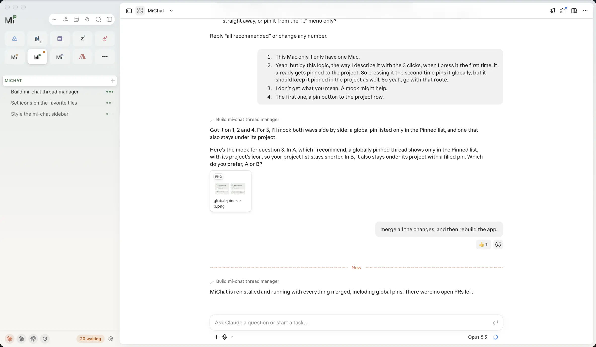
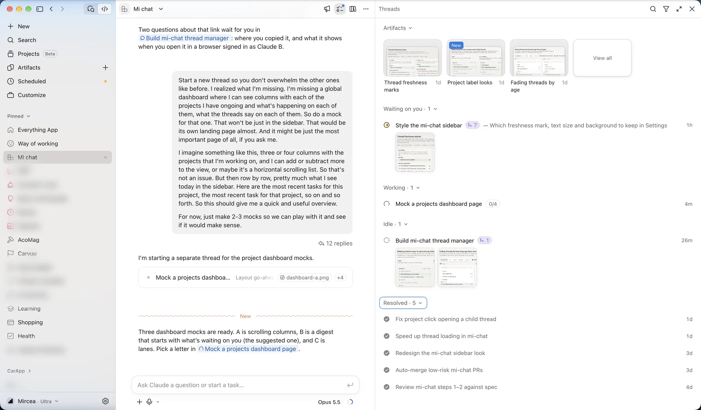
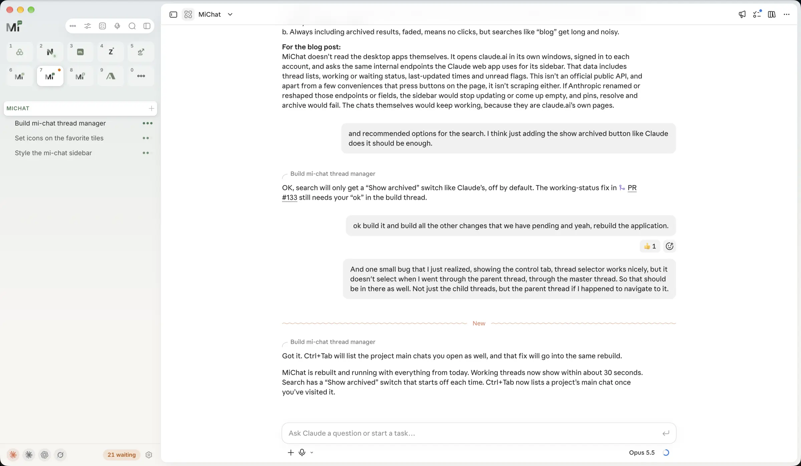
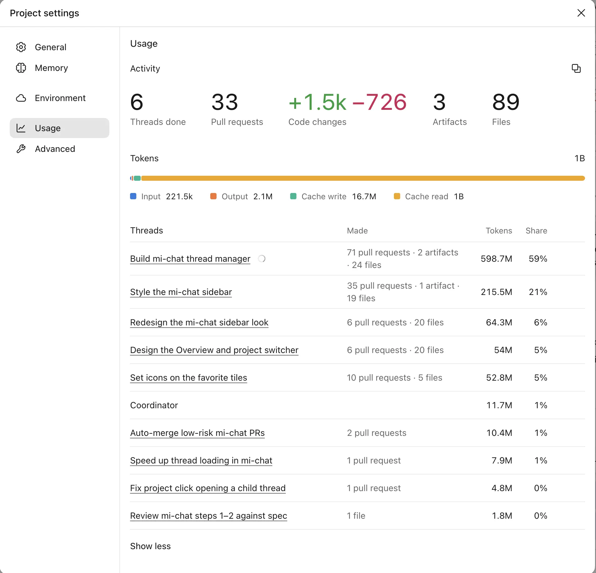

import ImageGallery from "../../../components/ImageGallery";
import DevlogStatStrip from "../../../components/charts/DevlogStatStrip.astro";
import DevlogRhythmChart from "../../../components/charts/DevlogRhythmChart.astro";

## Going all in

Lately I've gone all in on AI. And when I say all in, I mean two Claude Ultra subscriptions, one Grok Ultra subscription and, as a bonus, a ChatGPT Plus one, just for the flavor. Grok mostly lives in my git pipeline, where it does code reviews, so my actual day to day happens in the two Claude desktop apps.

With that much going on, I ran into a problem I'm sure many people in a similar situation know well: jumping between sessions. It's tricky enough inside a single app like Claude Code, but it gets messy fast once you're hopping across different apps and accounts.

To make things even more interesting, not even Claude is consistent with itself. My first account uses Claude Projects (currently in open beta and being rolled out gradually), where you talk to a coordinator that starts and manages sessions for you, though most of the time you end up talking to the sessions directly. My second account is newer, yet it doesn't have Projects, so it works with good old-fashioned sessions.

_My first account, with Claude Projects: the coordinator in the middle, its sessions on the right. Jumping between several projects like this gets tiring very fast._

Between the two accounts I have 18 projects. Most of them aren't client projects, but areas of my life, like health, career and finances, or even a little shopping assistant as well as internal projects such as this one. Still, I end up using about half of them every day.

## Death by a thousand clicks

I kept losing my way around all of it. And even when I knew exactly where I was going, the busy work of picking the right app, then the right project, then the right session, and then doing it all over again for the next one, was absolutely draining me. Imagine needing five clicks just to get where you want to go, then compound that over dozens or hundreds of jumps a day. Half the time I couldn't even remember which session I was looking for, so it felt less like navigating and more like wandering through a maze.

It didn't help that session statuses aren't very reliable yet either. Plenty of times a session was marked as waiting on me when it wasn't, or it was quietly waiting on me without saying so.

I had to do something about it.

## Don't reinvent the wheel

Since I didn't want to reinvent the wheel, I first looked at what was already out there. Aggregators like [T3 Chat](https://t3.chat) put all the models in one place, but they swap your subscriptions for their own plan or your API keys, which would be financial suicide with how much I use AI. I'm happy to pay $200 a month for $1,000 to $2,000 worth of tokens, but I'm not paying full price. I'll ride the subsidized AI train until the wheels come off :D

[CloudCLI](https://github.com/siteboon/claudecodeui) came closer, since it runs on top of your own CLI logins, but it has no Grok support. And [Moontors](https://github.com/moontors/moontors) looked promising, but it was still early and not something I could just pick up and use.

So my first plan was to build my own take on that idea: one chat app where every session runs through each vendor's official command-line tool, using my own logins. Before writing any real code, I had Claude run two quick experiments to see if it would hold up. Locally, everything worked: two Claude accounts ran side by side without stepping on each other's toes, and Grok even accepted my SuperGrok login. The catch was the cloud. Most of my sessions live there, in Claude Projects and Claude Code on the web, and the command-line tool could only reach them through workarounds: no way to start a session without an interactive prompt, no live replies (they showed up about 20 seconds later), and no real image attachments.

That's when it clicked: the chats themselves were fine, and what I actually needed was a better way to manage them. So instead of rebuilding the chat, I'd leave every chat exactly where it lives and only build on top of it the layer I needed: session management.

I asked Claude about the technical feasibility and it didn't seem complicated. As luck would have it, I already had some code watching over my sessions for a separate app of mine, so it was mostly a matter of refactoring that and making it more usable.

So MiChat ended up as an Electron app that opens claude.ai in its own windows, one per account, signed in like you normally would. That's a perfect fit for me, since 98% of my work happens on my MacBook, and when I need to orchestrate agents on the go, the Claude mobile app is good enough.

For the sidebar, it asks the same internal endpoints the Claude web app uses for its own sidebar: session lists, working or waiting status, last-updated times and unread flags. It's not an official public API, and apart from a few conveniences that press buttons on the page for me, it isn't scraping either (keep that detail in mind, because it comes back at the end).

I had a working version within a few hours. The week since then went into living with it and tweaking every little detail until it fit like a glove (one of those plastic surgical gloves, not the OJ one).

## Finding the right layout

I started with what I was most familiar with: a single sidebar with all the projects, and each project's sessions underneath. The issue was that it became very noisy very fast. Even after adding filters like "updated in the last 24 hours", there was just too much on screen, and the unreliable statuses only made it worse.

The first version showed the relative time each session was last updated ("3h ago"), which is accurate but not easy to scan. I needed something visual, so I tried fading the sessions based on how long they'd been quiet: recent ones stay crisp, older ones slowly fade into the background. That was a decent way to cut the noise, but it still wasn't quite enough on its own.

So I kept adding small workarounds. A snooze button for sessions that were still open but that I knew I wouldn't need until tomorrow. Settings for font size and status icons, so I could try out what worked best for me visually.

Then I thought what I was missing was an overview: a page with all the projects I'm working on, each with its most recent sessions in a column. I tried it both as a full page and with the overview on top and the open session below. The idea felt good in theory, but in practice I never stuck with it.

<ImageGallery
  client:visible
  images={[
    {
      src: "/mi-chat/assets/layout-sidebar.webp",
      alt: "MiChat sidebar listing every project with its sessions, older sessions faded",
      caption: "Everything in one sidebar, faded by age",
    },
    {
      src: "/mi-chat/assets/overview.webp",
      alt: "MiChat Overview with one column of sessions per project",
      caption: "The Overview: one column per project",
    },
    {
      src: "/mi-chat/assets/overview-split.webp",
      alt: "MiChat Overview on top with an open session below",
      caption: "Overview on top, session below",
    },
  ]}
/>

What I eventually landed on is clearly inspired by the [Arc browser](https://arc.net/): a set of favorites, each with its own shortcut key. Right now I have nine favorite projects in a row of tiles, plus a More button that opens a dropdown with the other ten or so. Pressing a shortcut key takes me straight to that project, and the sidebar shows only its sessions. Add a global "jump to any session" search, which pretty much every app has these days, and I can get to exactly where I need to go with pinpoint accuracy, instead of bumbling around like before.

_The favorites row: numbers 1 to 9 are the shortcut keys, 0 opens the rest._

## Sweating the details

I'm very finicky about design. I usually know what I want, and I'll keep iterating until it's close to perfect (both the UX and the UI), so a good chunk of the week went into all sorts of small tweaks to how it works and how it looks.

Not everything made the cut. I tried the real glass effect that a lot of newer Mac apps use, and at first it looked great, but in practice it started causing all sorts of visual bugs. I didn't want to spend more time fixing it, and I worried it would add some performance cost on top, so I dropped it. I kept the look, though: the frosted background you see in the screenshots is faked with a simple static gradient, which gets me most of the effect with none of the bugs.

One small addition I ended up using a lot more than I expected is a "Write a message" button. It opens a dedicated session where I can dictate something I want to send in an email or a WhatsApp message. I've found Claude to be really good at transcribing, especially in Romanian. I've used other tools like Granola for voice to text too, but the results were lacking: they give you what you said, word for word, while Claude transcribes it and trims it at the same time, so it comes out ready to send.

## By the numbers

Like with my other recent projects, Claude wrote the code, and I steered, reviewed and tested, all from inside a single Claude Project.

<DevlogStatStrip
  stats={[
    { value: "1 week", label: "From idea to daily driver" },
    { value: "352", label: "Commits" },
    { value: "132", label: "Pull requests" },
    { value: "~19M", label: "New tokens" },
  ]}
/>

The first day was the busiest by far: 106 commits on day one, which is the "working version within a few hours" part. After that it settled into a steady rhythm of tweaks.

<DevlogRhythmChart
  id="michat-rhythm"
  legendLabel="Commits / day"
  rangeLabel="Nov 7 – Nov 13"
  year={2026}
  data={[
    ["11-07", 106],
    ["11-08", 19],
    ["11-09", 53],
    ["11-10", 43],
    ["11-11", 58],
    ["11-12", 19],
    ["11-13", 54],
  ]}
/>

Out of the 132 pull requests, 131 are already merged, and Claude is by far the top committer. At some point I also set things up so that small sidebar UI changes merge themselves once the checks pass, so I only have to review the changes that actually matter.

<ImageGallery
  client:visible
  images={[
    {
      src: "/mi-chat/assets/github-insights.webp",
      alt: "GitHub Insights for the last month: 131 merged pull requests, 1 open",
      caption: "GitHub Insights, last month",
    },
    {
      src: "/mi-chat/assets/commits.webp",
      alt: "MiChat repository on GitHub: 352 commits and an auto-merge workflow",
      caption: "352 commits, auto-merge for UI tweaks",
    },
  ]}
/>

As for tokens, building the app and styling the sidebar took the lion's share:

The panel says about a billion tokens, which sounds a lot scarier than it is. About 98% of that is cache reads: every time Claude takes another step, it rereads the whole conversation so far, and every reread gets counted again. The new tokens, what I sent and what Claude wrote back, come to about 19 million, so that's the number I'd use to size a project like this.

## So, was it worth it?

For me, absolutely, and honestly more than I expected. Before MiChat, working with my agents meant fighting the desktop apps all day long: every time I wanted to check on something, I first had to click my way to it, and that made the whole thing feel like a chore. Now jumping between projects and sessions takes a keystroke, so all that busy work is simply gone. Working with agents has become a lot more fun, and I get a lot more done in a day because of it, which alone was worth the week.

Performance-wise it's been very smooth so far. The weakest spot is the initial load, which can take up to five seconds, and the first time a project opens it takes another few seconds to load its sessions. Once they're cached, though, it's a really smooth experience.

## Why I'm not open sourcing it (yet)

Naturally, I thought about making it open source and sharing it, which sounded like a great idea. When I asked Claude about it, though, it came back with a pretty solid counterargument. Remember those internal endpoints? If Anthropic renamed or reshaped them, the sidebar would stop updating or come up empty, and things like pinning, resolving and archiving sessions would fail. The chats would keep working, since they're Claude's own pages, but I'd be right back to clicking around. And the more visibility a tool like this gets, the more likely that change becomes.

For now, that risk isn't worth it, so I'm keeping it to myself, even though I'm fairly sure at least some people out there would find it useful. If you're one of them, or you're fighting the same problem and want some pointers, feel free to reach out. I'm happy to share what I learned, and maybe even the app itself.
