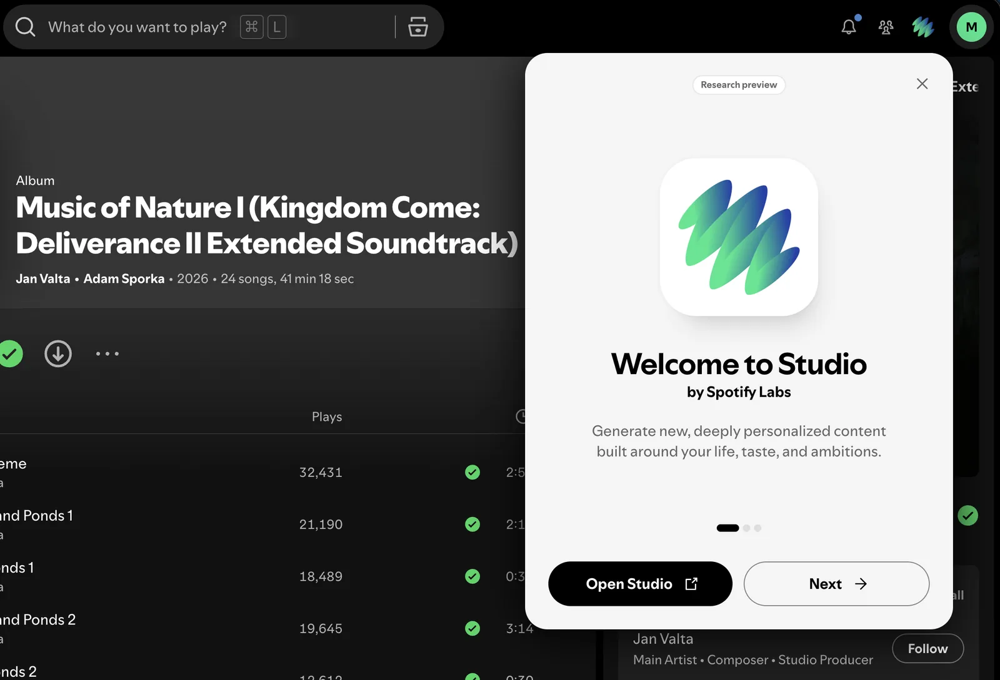
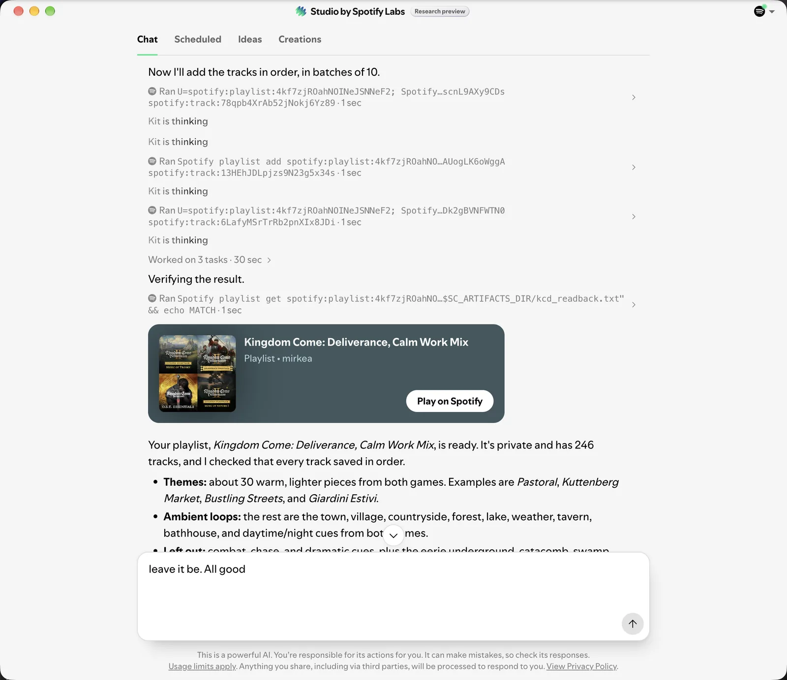

Recently I wanted to edit a Spotify playlist to get some chill background music while working. The [Kingdom Come: Deliverance](https://open.spotify.com/album/0XvTyYwQQhNXYFPbsCzmrg) soundtrack is a great choice most of the time, but in a few places the score takes a thriller / action angle, which is not ideal for a normal working setup (I don't need to feel like I'm about to get ambushed by bandits).

In the past I would have curated such a playlist myself, or searched for someone who already did. Nowadays this is a perfect task for AI. I could have asked Claude or ChatGPT to take control of my computer, but first I wanted to see if Spotify had a native solution. It felt like a no-brainer that they would have their own in-app agent by now. So I went looking, and lo and behold, a new button opened something called "Spotify Studio".

It was in "Research preview", so clearly new, but it promised exactly what I needed:

> Generate new, deeply personalized content

## Not quite an in-app agent

I was expecting a chat panel inside Spotify. Instead, Studio is its own standalone app, which I had to download, install and log into. As a user, I did not find the onboarding pleasant.

Once it was open, though, it worked exactly as I hoped: a chat interface over my Spotify data that generates playlists on demand. Shortly after, my [Kingdom Come: Deliverance, Calm Work Mix](https://open.spotify.com/playlist/4kf7zjROahNOINeJSNNeF2?si=87332c54812e4cd6) was ready, with the combat and chase cues left out. Exactly what I needed.

## Look under the hood

Look closer at what Studio shows while it works. "Kit" (the agent) announces "Now I'll add the tracks in order, in batches of 10", and then this scrolls by:

Every step is a shell command: `Spotify playlist add spotify:playlist:... spotify:track:...`, a "Kit is thinking" pause, the next command, and so on, until all 246 tracks are in. At the end it reads the playlist back into a file in an artifacts folder, checks it and prints `MATCH`.

That is not a deep in-app integration. It is a general-purpose agent driving a Spotify command-line tool, the same loop a coding agent runs on your laptop, wrapped in a desktop app with Spotify branding.

One of the biggest consumer apps in the world took the hack-ish route: no native feature, a separate app, an agent typing commands.

## So what

It doesn't matter much how sub-par the experience around a feature is, as long as it answers the most fundamental question:

> Does it solve the problem?

In my case it was a resounding yes.

And I think that's the real lesson for anyone building with AI right now, me included. Spotify could certainly build the agent into the main app. Maybe in a week, maybe in a month, but either way it would take longer than wrapping what already exists. So they shipped the dirty version as a research preview and get to learn whether people want it first. If that is good enough for Spotify, it is good enough for your first version too.
